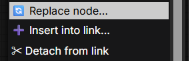

# ComfyUI-NodeTools

[中文](README.zh-CN.md)

Select a node, then right-click.
Multiple selection is supported.
Insert / Detach / Replace.
Written by AI.
I made this plugin only because I didn't want to use a pile of keyboard shortcuts.

## Install

Put this folder into `ComfyUI/custom_nodes/`

Restart ComfyUI, reload the browser tab (Ctrl+F5 for a hard reload).

## Requirements

Developed and tested on ComfyUI 0.43.0 with frontend 1.57.4. Other versions untested.

## Plans

Possibly node auto-layout, possibly not.
