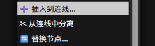

# ComfyUI-NodeTools

[English](README.md)

选中节点，然后右键。
支持多选。
节点插入/节点分离/节点替换。
由AI编写。
我制作这个插件只是因为不想用各种快捷键而已。

## 安装

把整个文件夹放进 `ComfyUI/custom_nodes/`

重启 ComfyUI，刷新浏览器标签页（Ctrl+F5 强制刷新）。

## 环境

开发和测试用的是 ComfyUI 0.43.0 + 前端 1.57.4。未测试其他版本。

## 计划

可能之后会加排版功能，也可能不会。
